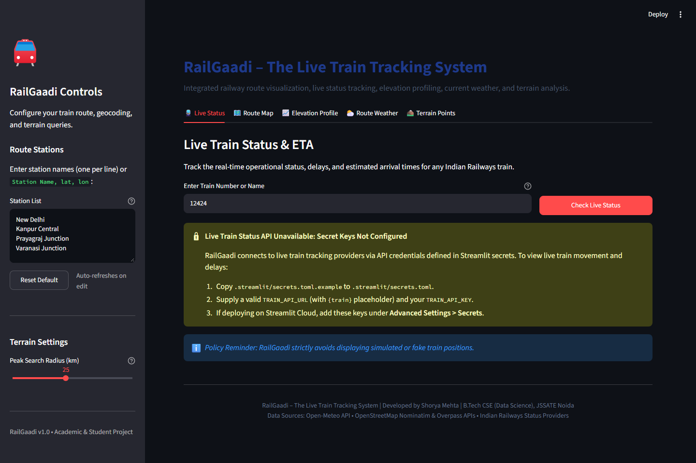
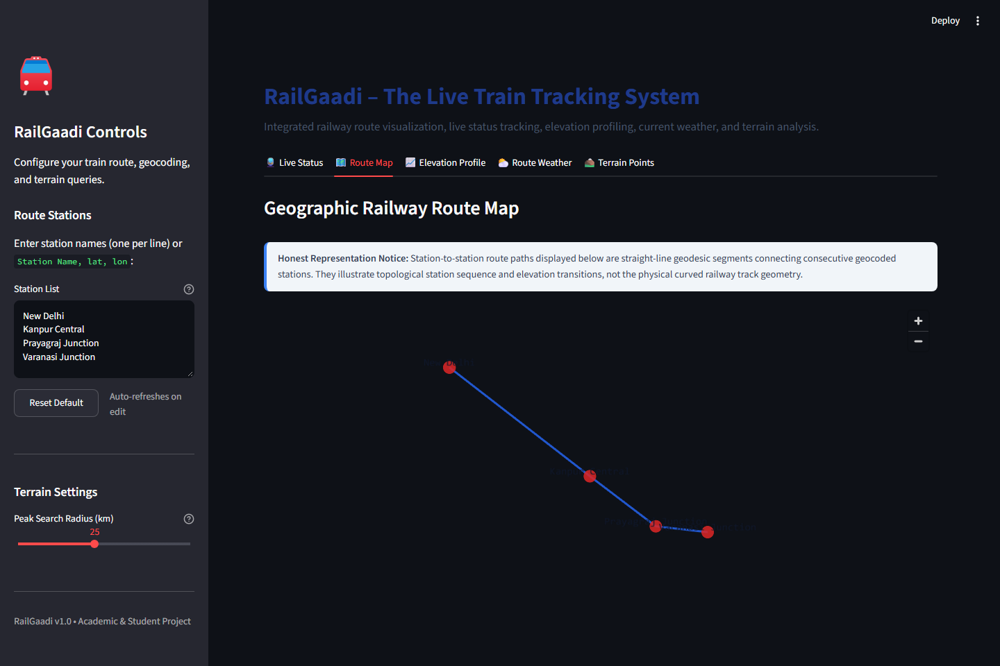
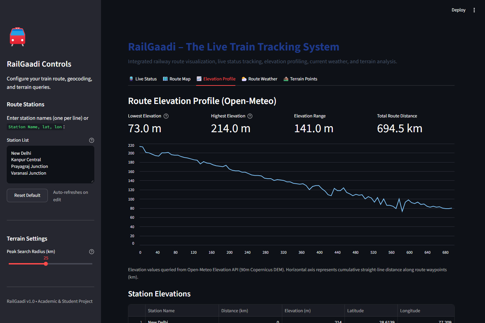
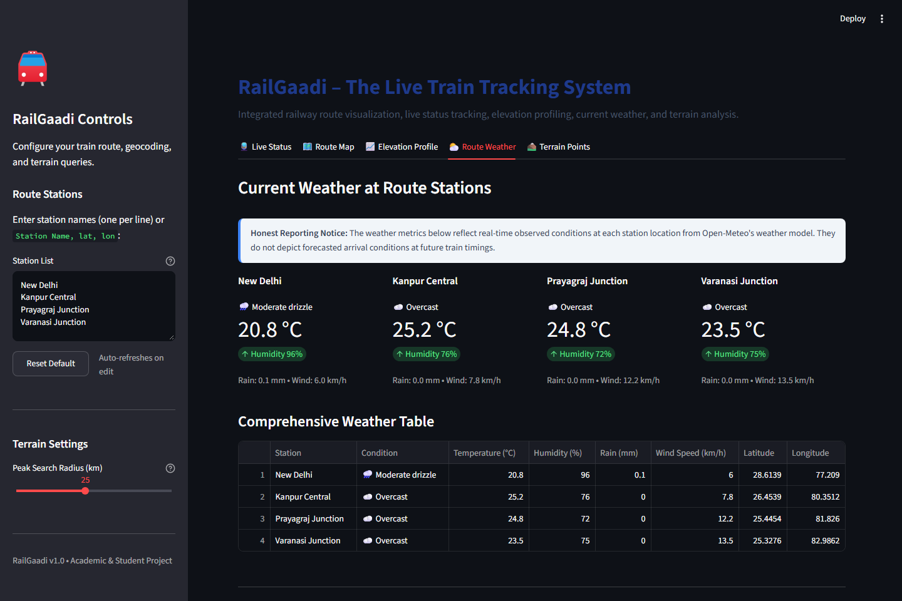
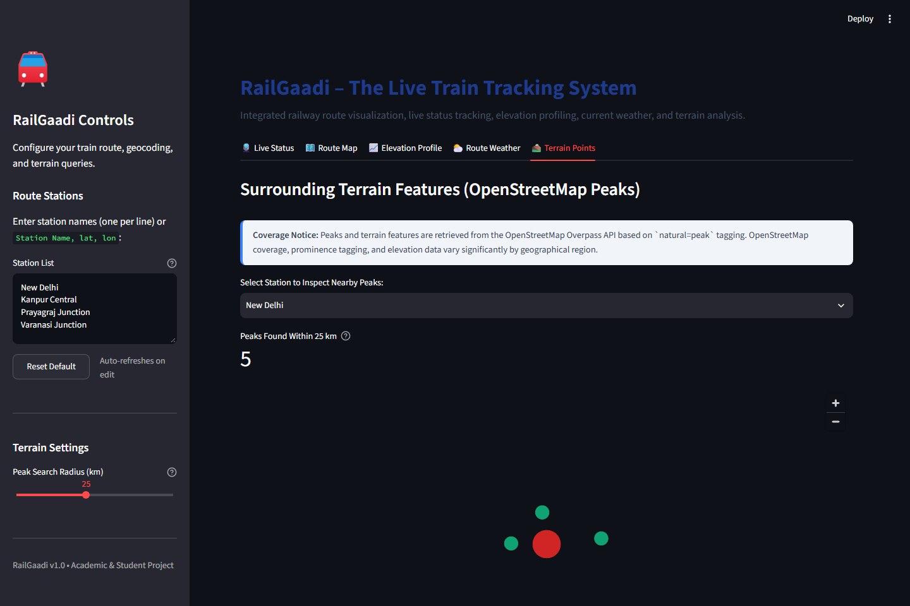
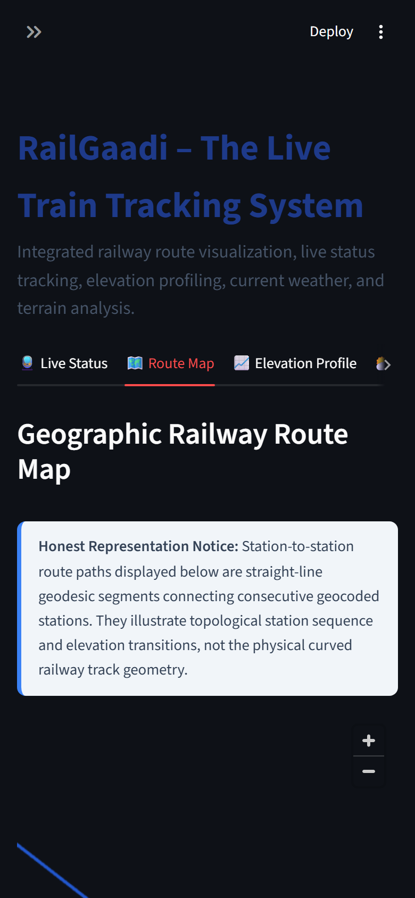

# RailGaadi – The Live Train Tracking System 🚆

[](https://streamlit.io/)
[](https://www.python.org/)
[](https://opensource.org/licenses/MIT)

An intelligent, multi-layered railway route visualization, live status tracking, elevation profiling, current weather, and terrain analysis system built using **Streamlit**, **Pydeck**, **Open-Meteo**, and **OpenStreetMap (Nominatim & Overpass)**.

---

## 👨‍🎓 Project & Academic Metadata
- **Student Name**: Shorya Mehta
- **Enrollment Number**: 2300911540108
- **Degree**: Bachelor of Technology in Computer Science and Engineering (Data Science)
- **Institution**: JSS Academy of Technical Education (JSSATE), Noida
- **Affiliation**: Dr. A.P.J. Abdul Kalam Technical University (AKTU), Lucknow
- **Internship**: Data Science Intern at Cognifyz Technologies (June 2026 – September 2026)
- **Supervisor & Coordinator**: Mr. Shubham Paul

---

## 🌟 Key Features

| Tab | Feature | Description & Upstream Service |
|---|---|---|
| 🚆 **Live Status** | Real-Time Train Tracking & ETA | Queries upstream train status APIs configured securely via Streamlit secrets. Enforces a strict anti-hallucination policy—displays clear "unavailable" status when unconfigured rather than fake positions. |
| 🗺️ **Route Map** | Interactive Pydeck Route Visualization | Supports entering station names (geocoded with OpenStreetMap Nominatim at max 1 req/sec with custom User-Agent) or direct `Name, lat, lon` coordinates. Displays station markers, labels, and geodesic pathlines. |
| 📈 **Elevation Profile** | Topographical Route Elevation | Samples up to 100 interpolation waypoints along the route and queries the Open-Meteo Elevation API (90m Copernicus DEM). Plots elevation curves and highlights lowest/highest points. |
| ⛅ **Route Weather** | Station Weather Conditions | Real-time weather for each station waypoint from Open-Meteo Forecast API (Temperature, Humidity, Rain, Wind Speed, WMO Condition decoding). |
| ⛰️ **Terrain Points** | Nearby Mountain Peaks & Terrain | Dispatches spatial queries to OpenStreetMap Overpass API for `natural=peak` features around stations with an adjustable search radius (5 to 50 km). |

---

## 📸 Screenshots Gallery

All screenshots below are captured from the live running application:

### 1. Live Train Status Tab
*Shows input for train tracking, secret key requirements, and strict anti-fabrication notices.*


### 2. Geographic Route Map Tab
*Pydeck map with station waypoints, labels, and straight-line geodesic connection across the Indo-Gangetic route.*


### 3. Route Elevation Profile Tab
*Continuous elevation drop profile from New Delhi (214 m) down to Varanasi (73 m), complete with metrics and station elevation table.*


### 4. Route Weather Tab
*Live weather cards and comprehensive table showing temperature, humidity, wind, and conditions across all stations.*


### 5. Terrain Points (OSM Peaks) Tab
*Overpass query result displaying natural peaks detected within 25 km of New Delhi on an interactive Pydeck terrain map.*


### 6. Responsive Mobile View
*Responsive stacked layout tested on a 390×844 mobile viewport.*
<p align="center">
  
</p>

---

## ⚖️ Transparent UI Disclaimers
In compliance with project design principles, RailGaadi presents honest representation captions:
1. **Route Paths**: Station-to-station paths are straight-line geodesic/Euclidean approximations connecting consecutive waypoints, not physical curved railway track geometry.
2. **Weather Data**: Weather metrics represent current, real-time observed conditions at each station location, not forecasted conditions at future train arrival times.
3. **Terrain Coverage**: OpenStreetMap peak density and elevation tags vary significantly across regions. Remote or unmapped terrain features may not be recorded in OSM.
4. **Live Train Positions**: Simulated or mock live train data is strictly disallowed. If upstream credentials are not configured or the service fails, the app cleanly shows an "unavailable" state.

---

## 🛠️ Local Installation & Setup

### Prerequisites
- Python 3.10 or higher
- Git

### 1. Clone the Repository
```bash
git clone https://github.com/YOUR_USERNAME/railgaadi.git
cd railgaadi
```

### 2. Set Up Virtual Environment
```bash
# On Windows
python -m venv .venv
.\.venv\Scripts\activate

# On Linux / macOS
python3 -m venv .venv
source .venv/bin/activate
```

### 3. Install Dependencies
```bash
pip install -r requirements.txt
```

### 4. Configure Secrets (Optional)
To enable real-time train tracking on the Live Status tab:
```bash
# Copy example configuration
cp .streamlit/secrets.toml.example .streamlit/secrets.toml
```
Edit `.streamlit/secrets.toml` with your credentials:
```toml
TRAIN_API_URL = "https://your-api-endpoint.com/api/v1/trains/{train}/live"
TRAIN_API_KEY = "your_secret_api_key"
TRAIN_API_KEY_HEADER = "X-RapidAPI-Key"
TRAIN_API_HOST = "your-api-host.p.rapidapi.com"
```
*(Note: If omitted, the app runs smoothly with Live Status showing the unconfigured notice).*

### 5. Run the Application
```bash
streamlit run app.py
```
Open your browser at `http://localhost:8501`.

---

## ☁️ Deployment on Streamlit Community Cloud

Follow these step-by-step instructions to deploy RailGaadi on Streamlit Community Cloud:

1. **Push to GitHub**:
   ```bash
   git init
   git add .
   git commit -m "Initial release of RailGaadi – The Live Train Tracking System"
   git branch -M main
   git remote add origin https://github.com/<YOUR_GITHUB_USERNAME>/railgaadi.git
   git push -u origin main
   ```

2. **Connect Streamlit Community Cloud**:
   - Navigate to [share.streamlit.io](https://share.streamlit.io/) and sign in with your GitHub account.
   - Click **"New app"**.
   - Select your repository: `<YOUR_GITHUB_USERNAME>/railgaadi`.
   - Branch: `main`.
   - Main file path: `app.py`.

3. **Configure Secrets**:
   - Before clicking Deploy, expand **"Advanced settings..."**.
   - In the **Secrets** text box, paste your API configuration:
     ```toml
     TRAIN_API_URL = "https://your-api-endpoint.com/api/v1/trains/{train}/live"
     TRAIN_API_KEY = "your_secret_api_key"
     TRAIN_API_KEY_HEADER = "X-RapidAPI-Key"
     TRAIN_API_HOST = "your-api-host.p.rapidapi.com"
     ```
   - Click **Save**.

4. **Launch**:
   - Click **"Deploy!"**.
   - Streamlit Cloud will install dependencies from `requirements.txt` and launch the application.

---

## 📂 Project Structure

```text
railgaadi/
├── .gitignore                      # Git exclusion rules (.venv, secrets.toml, etc.)
├── .streamlit/
│   └── secrets.toml.example        # Secrets template with placeholder keys only
├── app.py                          # Complete Streamlit multi-tab application
├── capture_screenshots.py          # Automated CDP headless browser screenshot tool
├── requirements.txt                # Python package dependencies
├── README.md                       # Complete project documentation
├── TEST_NOTES.md                   # Detailed log of real test outcomes and failure modes
└── screenshots/                    # Captured evidence of the running application
    ├── 01_live_status_tab.png
    ├── 02_route_map_tab.png
    ├── 03_elevation_profile_tab.png
    ├── 04_route_weather_tab.png
    ├── 05_terrain_points_tab.png
    └── 06_mobile_view.png
```

---

## 📜 License
This project is licensed under the MIT License - see the LICENSE file for details.
